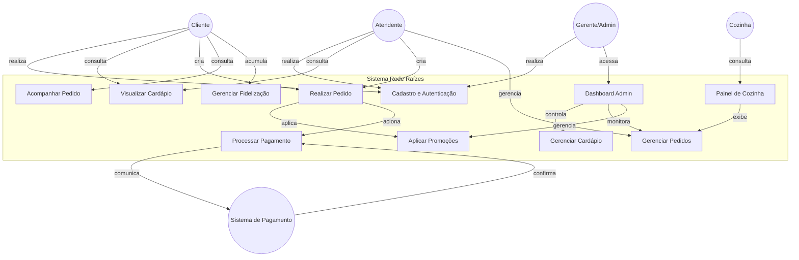
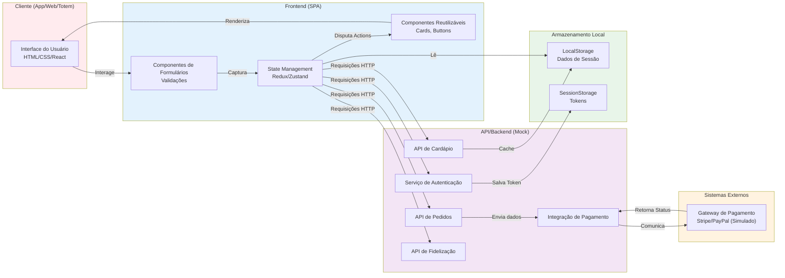
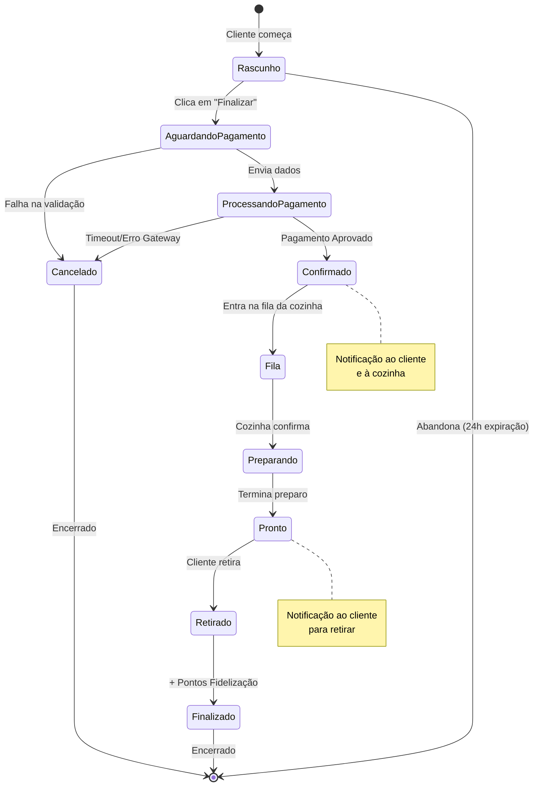

# DIAGRAMAS UML - CASOS DE USO E JORNADA

## 1. DIAGRAMA DE CASOS DE USO

---

## 2. DESCRIÇÃO DETALHADA DO CASO DE USO: "REALIZAR PAGAMENTO"

### **Identificação**
- **ID:** UC-07
- **Nome:** Realizar Pagamento
- **Ator Principal:** Cliente
- **Ator Secundário:** Sistema de Pagamento Externo
- **Prioridade:** ALTA
- **Pré-condições:**
  - Cliente autenticado
  - Pedido com itens confirmados e total calculado
  - Sistema de pagamento externo disponível

### **Fluxo Principal**
1. Cliente revisa pedido e valor total
2. Cliente seleciona método de pagamento (Crédito, Débito, PIX)
3. Sistema exibe formulário seguro (simulado)
4. Cliente insere dados de pagamento
5. Sistema envia requisição para gateway externo
6. Gateway retorna sucesso/falha
7. Sistema exibe confirmação visual
8. Pedido é registrado com status "Confirmado"
9. Notificação enviada à cozinha e cliente

### **Fluxo Alternativo - Pagamento Rejeitado**
1. Em [6], gateway retorna erro
2. Sistema exibe mensagem de erro amigável
3. Cliente pode tentar novamente ou cancelar
4. Se cancelar, pedido é descartado

### **Fluxo Alternativo - Timeout**
1. Requisição ao gateway demora > 30s
2. Sistema exibe "Processando..."
3. Após timeout, solicita confirmação manual

### **Pós-condições**
- Pagamento processado e registrado
- Histórico de transação salvo
- Pontos de fidelização adicionados (se aplicável)
- Pedido pronto para cozinha

### **Regras de Negócio**
- RN01: Valor mínimo de pedido = R$15,00
- RN02: Desconto de cupom não pode exceder 50% do total
- RN03: Dados sensíveis de pagamento NUNCA são armazenados
- RN04: Transação deve ser confirmada dentro de 2 minutos

### **Requisitos Não-Funcionais**
- Criptografia TLS 1.2+
- Resposta < 3 segundos
- Registrar tentativas falhadas para análise

---

## 3. DIAGRAMA DE JORNADA DO USUÁRIO (CLIENTE)

```mermaid
graph LR
    A["📱 Acesso ao App<br/>Carregar Tela Inicial"] -->|Não autenticado| B["🔐 Tela de Login<br/>Opção: Cadastrar"]
    B -->|Novo usuário| C["📝 Cadastro<br/>Email, Senha<br/>✓ Consentimento LGPD"]
    C -->|Validação OK| D["✅ Conta Criada<br/>Verificação Email"]
    B -->|Já tem conta| E["🔑 Login Realizado"]
    D -->|Email confirmado| E
    
    E -->|Primeira vez| F["🗺️ Selecionar Unidade<br/>Localização/Mapa"]
    E -->|Já selecionou| G["🍔 Visualizar Cardápio<br/>Categorias"]
    F -->|Confirma unidade| G
    
    G -->|Navega| H["📋 Detalhes do Produto<br/>Preço, Descrição<br/>Alérgenos"]
    H -->|Adiciona| I["🛒 Item no Carrinho<br/>Quantidade +/-"]
    I -->|Continua| G
    I -->|Finaliza| J["💳 Revisar Carrinho<br/>Total"]
    
    J -->|Aplica cupom| K["🎁 Promoção Aplicada<br/>Novo Total"]
    K -->|Continua| L["💰 Selecionar Pagamento<br/>Crédito/Débito/PIX"]
    J -->|Sem cupom| L
    
    L -->|Dados inseridos| M["🔄 Processando Pagamento<br/>Aguarde..."]
    M -->|Sucesso| N["✅ Pedido Confirmado!<br/>Número #12345<br/>Tempo estimado: 25min"]
    M -->|Falha| O["❌ Pagamento Recusado<br/>Tentar novamente?"]
    O -->|Sim| L
    O -->|Não| P["📋 Pedido Salvo<br/>em Rascunho"]
    
    N -->|Aguardando| Q["👀 Acompanhamento<br/>Status em Tempo Real"]
    Q -->|Fase 1| R["✋ Pedido Confirmado<br/>Entrando na Fila"]
    R -->|Fase 2| S["👨‍🍳 Preparando<br/>12/25 min"]
    S -->|Fase 3| T["🎉 Pronto!<br/>Notificação"]
    T -->|Fase 4| U["🏃 Retirado<br/>Obrigado!"]
    
    U -->|Reflexão| V["⭐ Avaliar Pedido<br/>Comentário Opcional"]
    V -->|Confirma| W["🎁 +50 Pontos de Fidelização<br/>Total: 350 pts"]
    W -->|Visualizar| X["👑 Seu Status: PRATA<br/>Próximo: OURO (100 pts)"]
    
    X -->|Navega| G
    
    style A fill:#e1f5ff
    style C fill:#fff3e0
    style N fill:#c8e6c9
    style W fill:#f3e5f5
```

---

## 4. DIAGRAMA DE FLUXO DE DADOS

---

## 5. FLUXO DE ESTADOS DO PEDIDO

---

## 6. MATRIZ DE ATORES E FUNCIONALIDADES

| Funcionalidade | Cliente | Atendente | Cozinha | Gerente | Pagamento |
|---|---|---|---|---|---|
| Autenticação | ✅ | ✅ | ❌ | ✅ | ❌ |
| Ver Cardápio | ✅ | ✅ | ❌ | ✅ | ❌ |
| Criar Pedido | ✅ | ✅ | ❌ | ✅ | ❌ |
| Visualizar Pedido | ✅ | ✅ | ✅ | ✅ | ❌ |
| Processar Pagamento | ✅ | ❌ | ❌ | ❌ | ✅ |
| Gerenciar Pedidos | ❌ | ✅ | ✅ | ✅ | ❌ |
| Ver Relatórios | ❌ | ❌ | ❌ | ✅ | ❌ |
| Editar Cardápio | ❌ | ❌ | ❌ | ✅ | ❌ |

